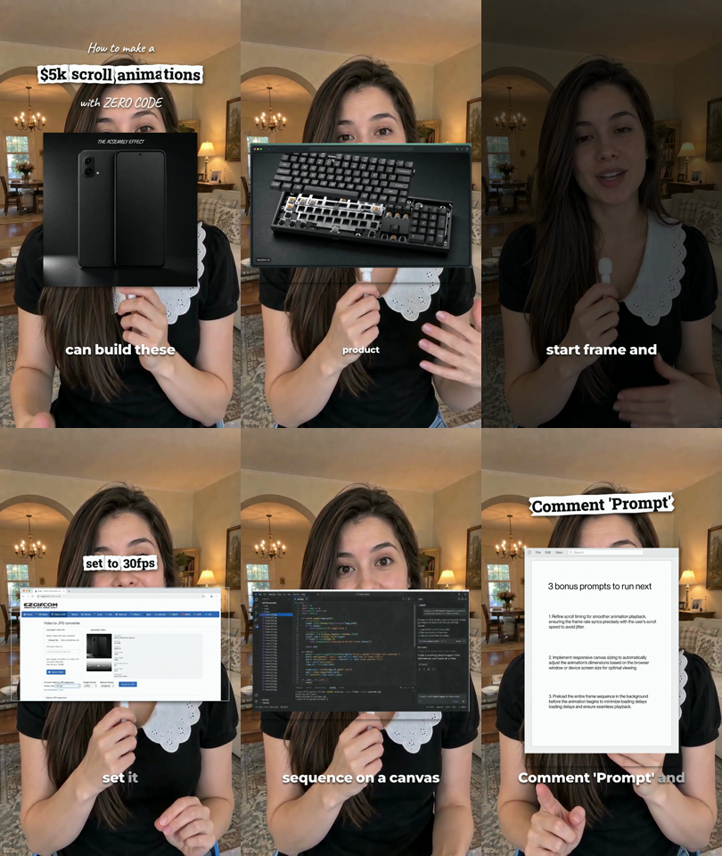
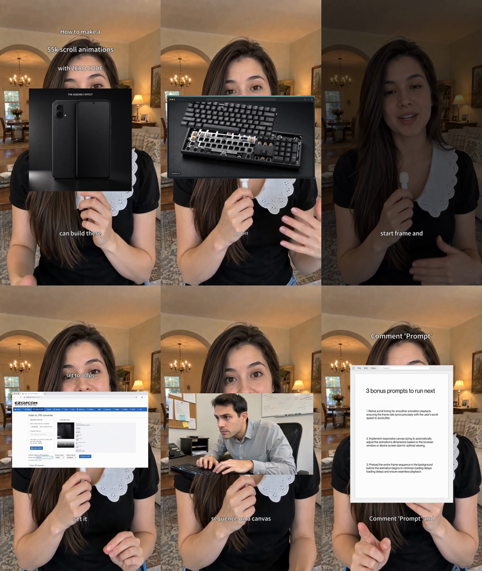

# Jianying Headless

面向剪映专业版的本地自动化工具。通过结构化剪辑计划生成可编辑草稿，
在独立副本中修改多轨工程，并调用本机剪映引擎导出 MP4。

**主要适配版本：11.5.0 · 兼容版本：11.4.2**

**Windows 已适配**：剪映专业版 Windows 11.5.0.14471 支持草稿构建、首页登记、结构回读，
以及固定 DLL 指纹下的基础单时间线原生导出。详见 [Windows 版本说明](docs/WINDOWS.md)。

**首次使用请从 [从零生成第一个剪映草稿](docs/GETTING-STARTED.md) 开始。**
教程包含安装前提、环境检查、拖入自己的视频、首页登记、保存重开和常见报错处理。
11.5.0 仍需匹配具体安装身份与工具链，尚不保证任意电脑安装即用。

项目适用于 AI 视频工作流的工程交接、批量草稿生成和 Agent 辅助剪辑。
提供 Python 命令行入口及配套 Agent Skill。它不是剪映官方 SDK，运行时需要安装匹配版本的剪映。

## 核心功能

| 功能 | 支持范围 |
| --- | --- |
| 生成可编辑草稿 | 视频分段、多轨组合、变速、音量、画中画、字幕和标题 |
| 导入本地素材 | 视频、PNG、JPEG、GIF、配音、音乐和音效 |
| 本地字体 | 新建文字或在副本中换字体，静态 OTF/TTF 随草稿保存；详见[字体说明](docs/LOCAL-FONTS.md) |
| 基础动画 | 位置、缩放、旋转、透明度和音量的线性关键帧 |
| 原生效果 | 六类静态几何蒙版、叠化转场、轻微抖动；需要匹配的本机资源与使用权限 |
| 官方能力 | 生成并应用 TTS、歌词动效和剪同款模板请求，并通过官方 Lyra 链路渲染；资源 ref 与执行上下文由当前官方 Agent 会话提供 |
| 自动歌词 | 使用本地 `faster-whisper` 从音频或 JYPACK 已用音乐区间生成逐词时间、SRT 和可直接构建的官方歌词计划 |
| JYPACK 检查 | 只读校验 JY/ZIP、加密时间线、TTS 音频、逐字歌词和官方模板包证据 |
| JYPACK 渲染 | 匹配剪映已导入的同一时间线，使用本机原生 ExportService 渲染 TTS、歌词模板、贴纸与动画 |
| 编辑已有工程 | 检查源草稿，在独立副本中修改，不覆盖原项目 |
| 原生视频导出 | 通过本机剪映引擎将已验证快照导出为 H.264/AAC MP4 |
| 环境与工程检查 | 核对运行版本、组件身份、素材完整性和草稿保存结果 |

核心流程为：**素材与剪辑计划 → 可编辑剪映草稿 → 原生引擎导出**。
剪映中后续手工修改的内容不会自动同步回原计划或旧导出快照。

剪映 11.5.0 自带 Agent Runtime 时，还可生成并应用 TTS、歌词动效和官方模板包的
`DraftEditing` 请求，再调用官方 Lyra 链路渲染。入口、计划格式和资源边界见[官方能力适配](docs/OFFICIAL-FEATURES.md)。

`engine/draftediting_runtime.py` 直接驱动官方 `lyra-cli` 的 blueprint 链路
（`init` → `sync` → `apply`），把 Selection Expression 应用到真实草稿。
宿主校验、命令契约、ASCII 路径、草稿根与主轨审计等实测硬约束见[官方 DraftEditing 链路](docs/DRAFTEDITING-RUNTIME.md)。

`engine/headless_pipeline.py` 把「自动识别 → 官方歌词模板 → TTS → 官方渲染」串成一条无人值守的命令，
对齐规则、每步产物与实测结果见[无头端到端流水线](docs/HEADLESS-PIPELINE.md)：

```powershell
python engine\headless_pipeline.py run `
  --draft "C:\...\com.lveditor.draft\my-draft" `
  --jypack C:\absolute\my-draft.jypack `
  --out C:\absolute\work\pipeline-run-1 --model large-v3 --render
```

Windows 可直接从音频或已导入的 JYPACK 自动生成歌词。JYPACK 模式会避开 TTS 轨，
识别实际使用的音乐区间，并把源音频时间换算到草稿时间轴：

```powershell
pip install -r requirements-lyrics.txt
python engine\lyrics_generate.py `
  --jypack C:\absolute\sample.jypack `
  --model large-v3 `
  --out C:\absolute\work\auto-lyrics
```

输出包含 `lyrics.json`、`lyrics.srt` 和 `official-features.plan.json`。模型默认只从本机缓存加载；
首次下载需显式添加 `--allow-download`。完整参数与调用链见[官方能力适配](docs/OFFICIAL-FEATURES.md)。

## Hypit 协作案例

一个约 **50.23 秒**的 IG 滚动动画教程展示了从 Hypit 到剪映的工程交接。
转换使用原工程的独立画面、配音、图片和文字时间安排，而不是仅导入一条最终成片。

| 工程内容 | 数量 |
| --- | --- |
| 原始素材 | 39 份 |
| 视频与图片 | 8 条轨道、38 个片段 |
| 独立配音 | 1 条轨道、7 个片段 |
| 可编辑文字 | 14 条轨道、109 个片段 |
| 合计 | 23 条轨道、154 个片段 |

该案例已在剪映 11.5.0 完成构建、打开播放、保存、完全退出、冷重开和结构回读，
并通过原生导出的 **1507 / 1507 帧**检查与完整解码检查。

### 画面对照

| Hypit 原成片 | 剪映工程原生导出 |
| --- | --- |
|  |  |

两组图片均取自真实案例的 1、8、17、28、37、48 秒。展示的是可编辑工程交接，
**不是视觉无损转换**：特殊字体、逐词颜色动画、部分裁切与阴影未原样保留，
第 37 秒的补充画面也存在差异。完整主观视听验收尚未完成。

详见 [Hypit 协作案例](docs/HYPIT-COLLABORATION.md) 和 [媒体说明](docs/media/README.md)。
当前转换是单向、按项目实现；不提供任意 Hypit 工程的一键无损转换或双向同步。

## 运行环境

macOS：

- Apple Silicon Mac，macOS 26.0+；已验证环境为 macOS 26.5.1。
- 剪映专业版 11.5.0，或兼容配置对应的 11.4.2。
- Python 3.9+、FFmpeg / ffprobe、Xcode Command Line Tools。
- 已验证桥接工具链：Apple clang 21.0.0 / macOS SDK 26.5。

Windows：

- 64 位 Windows 10/11 与 64 位 Python 3.9+、FFmpeg / ffprobe。
- 剪映专业版 Windows **11.5.0.14471**，默认安装位置。
- 支持草稿构建、首页登记、结构回读与离线计划；**原生导出未适配**。
- 完整说明见 [Windows 版本说明](docs/WINDOWS.md)。

应用版本、build、官方库哈希、签名与开发者身份均有检查。
未知版本或不匹配组件会被拒绝，不通过放宽校验强行运行。干净机器安装验收尚未完成。
官方引擎、账号数据、原始工程素材库和效果资源不随源码分发。

构建工具选择、安装诊断、登记恢复及字体支持的进展和待验限制见
[Issue 修复进展](docs/ISSUE-REMEDIATION.md)。环境检查通过不等于任意电脑兼容。

## 快速开始

```bash
git clone https://github.com/mcncarl/jianying-headless.git
cd jianying-headless
python3 tools/build_native_codec.py
python3 skills/yichen-jianying-edit/scripts/headless_draft.py doctor
```

Windows 不需要编译桥接组件，直接运行体检与新手流程：

```powershell
$env:PYTHONUTF8 = "1"
python tools\start_here.py check
python engine\jy14_headless.py doctor
```

`doctor` 是**环境检查命令**：检查剪映版本、组件身份和必要工具。
检查通过表示环境符合运行条件，不代表任意草稿都已通过画面、声音或导出验收。

桥接构建只编译项目源码并链接本机已安装程序库，不下载剪映、不修改官方库或账号权益。
编译结果必须匹配固定哈希，否则停止。

按 [计划格式](skills/yichen-jianying-edit/references/headless-macos.md) 准备 JSON，
或参考 [基础计划](examples/basic.plan.json) 和 [Hypit 交接格式示例](examples/hypit-handoff.plan.json)。
示例中的素材路径须替换为有权使用的本地文件。

```bash
python3 skills/yichen-jianying-edit/scripts/headless_draft.py build \
  --plan /absolute/path/to/plan.json --out "$PWD/work/new-build"
python3 skills/yichen-jianying-edit/scripts/headless_draft.py verify-build \
  --build "$PWD/work/new-build"
```

保存当前工作并完全退出剪映后，将新草稿登记到本机首页：

```bash
python3 skills/yichen-jianying-edit/scripts/headless_draft.py publish \
  --build "$PWD/work/new-build" --audit "$PWD/work/new-publish-audit"
```

`publish` 在此仅指本机首页登记，不是互联网发布。生成的草稿仍需实际打开、播放和保存检查。
需要成片时，可独立导出已验证快照：

```bash
python3 skills/yichen-jianying-edit/scripts/headless_draft.py export \
  --build "$PWD/work/new-build" --out "$PWD/work/new-export"
```

输出目录须不存在，成片为该目录下的 `render.mp4`。
导出在隔离进程中运行，默认不联网、不读取账号数据。

## Agent Skill

`skills/yichen-jianying-edit/` 提供 Agent 调用入口、口播计划辅助脚本与操作参考。
Skill 不包含剪映引擎；独立安装后仍需检出核心项目，并指定其路径：

```bash
export JIANYING_HEADLESS_ROOT="/absolute/path/to/jianying-headless"
```

安装说明见 [独立 Skill](skills/yichen-jianying-edit/README.md)。
Skill 另收录于 [yichen-skills](https://github.com/mcncarl/yichen-skills/tree/main/yichen-jianying-edit)。

## 当前限制

- 复合片段仅支持实验性的离线修改与冻结快照导出，尚不能交付为保存可靠的可编辑嵌套草稿。
- 图片/GIF 样本曾出现间歇少一帧；严格帧数检查会拒绝缺帧输出，根因尚未解决。
- 不支持任意剪映版本、任意效果组合、在线模板、资源下载、云端工程或账号权益获取。
- 官方能力适配器不自行搜索或下载音色、歌词动画和模板；实际调用需要官方 Agent Runtime
  提供的 `blueprint_ref`，并继续受账号权益、资源许可和客户端版本约束。
- DraftEditing 链路只识别剪映草稿根下的草稿，且工作区路径必须为纯 ASCII；官方模板的
  多输入槽位文本分发尚未打通，应用后需在剪映中核对槽位文案。
- 高清黑白滤镜与橙色描边花字已退出支持范围；含这些效果的计划或旧快照会明确报错。
- 工程结构检查、原生播放、视觉一致性、主观听感与素材许可是不同的验收项目。

详细结果及已知问题见 [验证状态](docs/VERIFICATION.md)。

## 项目结构与验证

| 目录 | 内容 |
| --- | --- |
| `engine/` | 草稿构建、独立副本编辑、资源校验与原生导出 |
| `bridge/` | 文件与管道桥接源码、保留来源声明的接口头文件 |
| `skills/` | Agent Skill 及配套参考 |
| `tools/`、`tests/` | 构建、源码包装检查与可移植测试 |
| `licenses/` | 第三方许可证 |

```bash
python3 tools/check_package.py
python3 -m unittest discover -s tests -v
```

专项原生测试的本机素材与证据不随仓库分发；源码检查不能替代实际工程验收。

## 许可与来源

原创部分采用 [个人学习和非商业使用许可](LICENSE)；商业使用需取得作者书面授权。
第三方内容继续适用原许可证，详见 [第三方声明](THIRD_PARTY_NOTICES.md)。
本项目不是 MIT / Apache-2.0 整包授权，代码许可也不包含剪映集成授权、账号权益或素材许可。
分发边界见 [分发范围](docs/DISTRIBUTION-SCOPE.md)。
